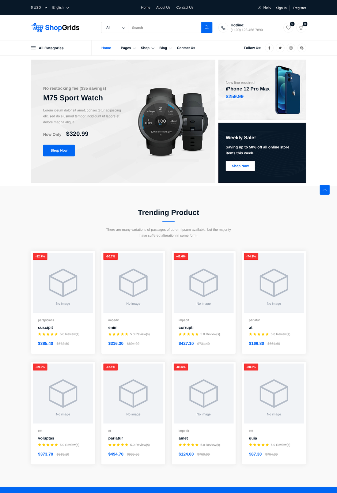
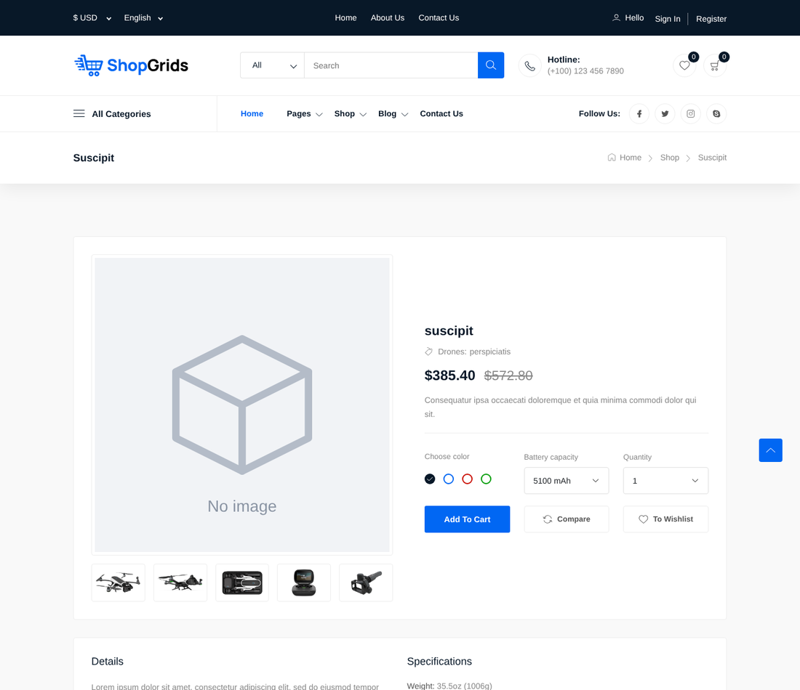
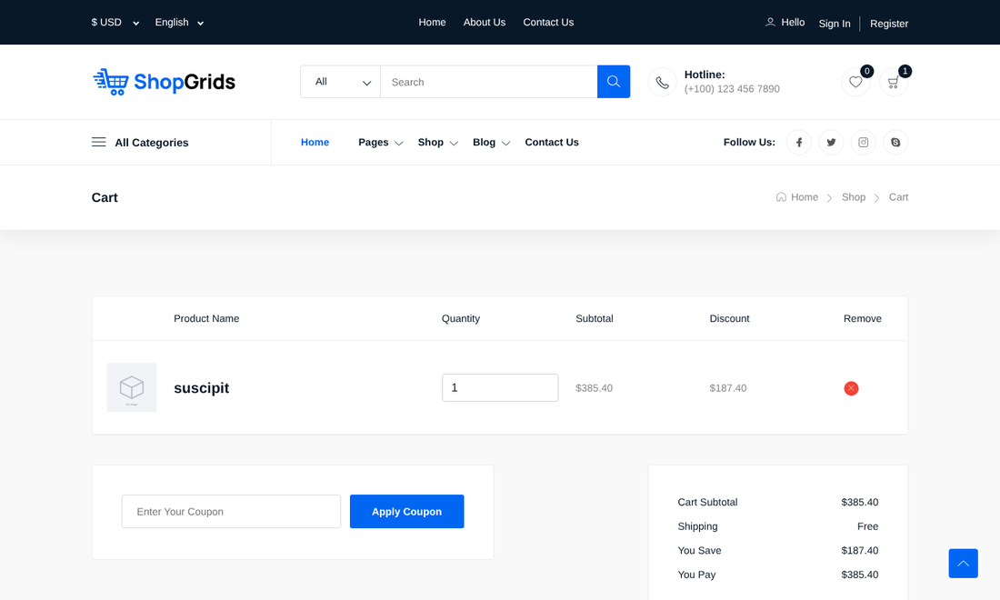
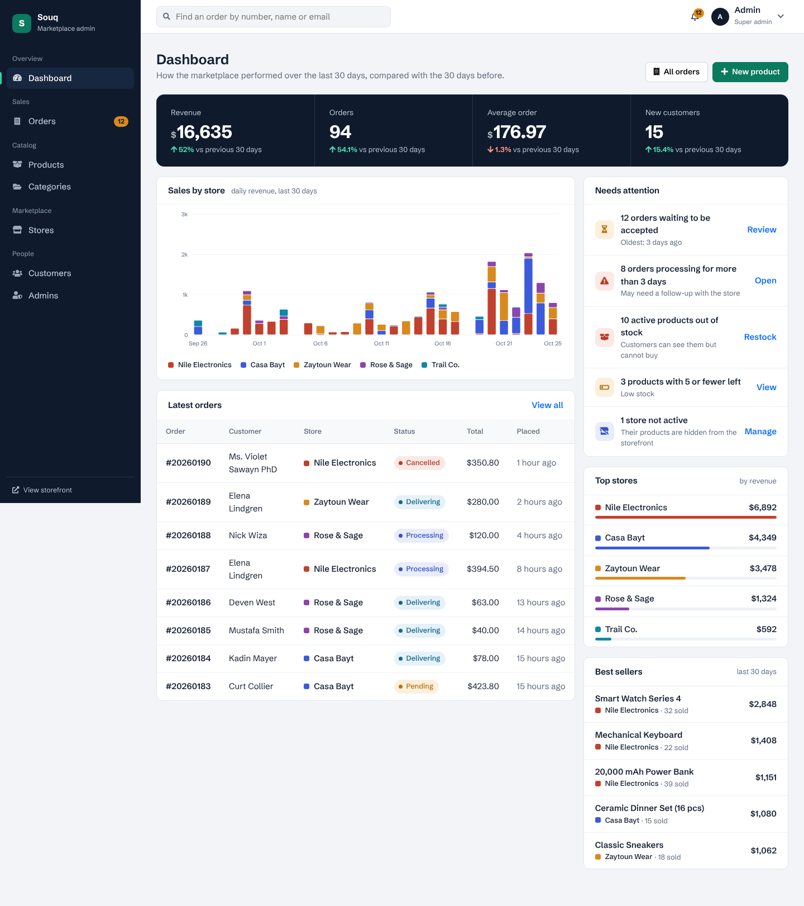
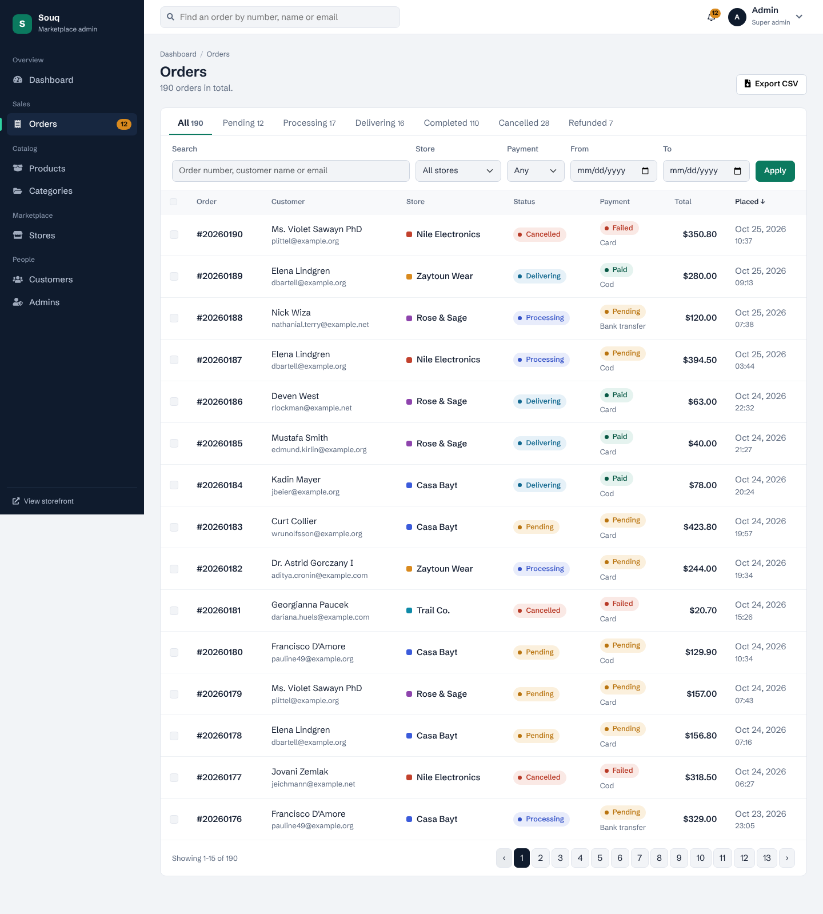
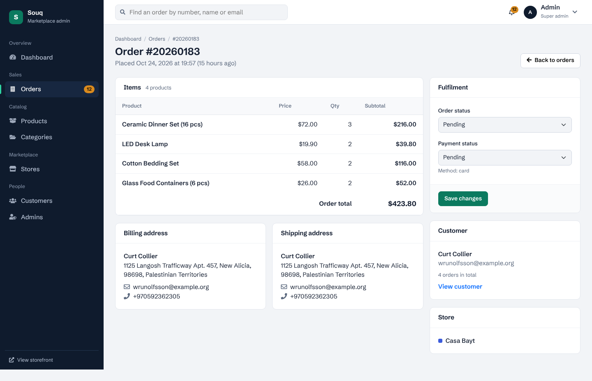
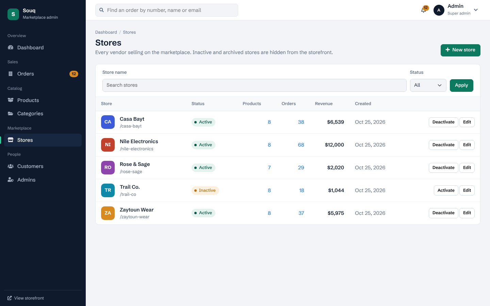
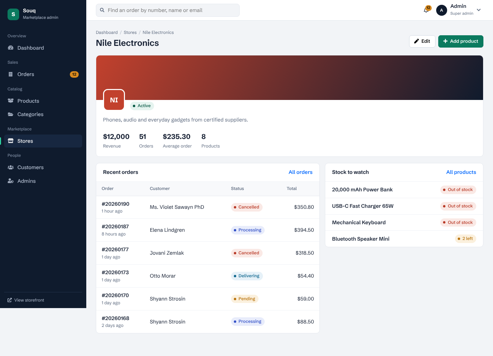
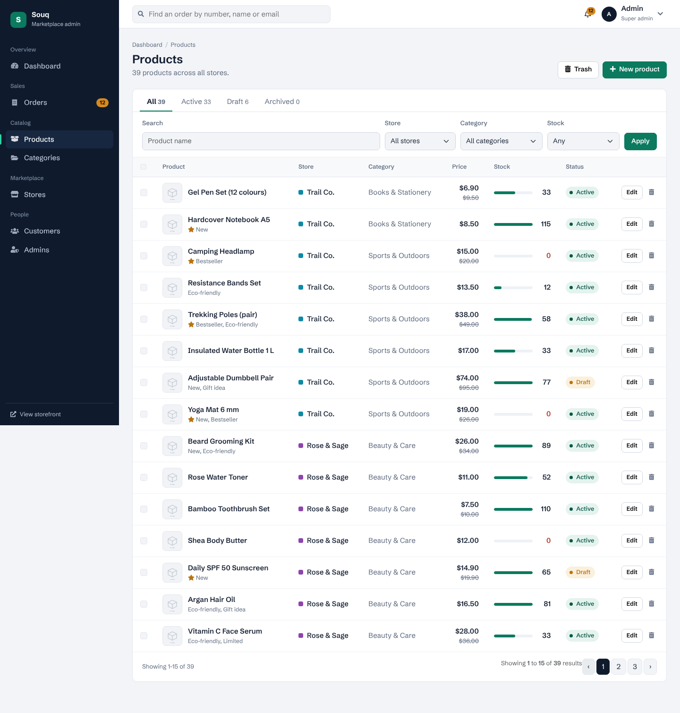

# Laravel Multi-Vendor E-Commerce

A full-stack multi-vendor e-commerce platform built with **Laravel 10** and Blade. Stores and their products are managed from a dashboard, customers browse the storefront, add to cart and check out, and orders trigger notifications and stock updates automatically.


## Screenshots

Captured from the running application with the seeded demo data (demo products have no photos, so they show a placeholder image).

| Storefront | Product details |
|---|---|
|  |  |

**Cart**



**Admin panel**



| Orders | Order detail |
|---|---|
|  |  |

| Stores | Store detail |
|---|---|
|  |  |



## Features

**Storefront**
- Home page and product listing with product detail pages (slug URLs)
- Shopping cart and checkout with billing/shipping addresses
- Currency converter
- Registration, login, password reset and email verification
- Two-factor authentication (2FA)

**Admin panel**
- Dashboard: revenue, orders, average order and new customers for the last 30 days against the 30 before, daily sales stacked by store, a "needs attention" list (pending and stuck orders, out-of-stock and low-stock products, inactive stores), top stores and best sellers
- Orders: status tabs with live counts, filters (search, store, payment, date range), sorting, bulk status change, CSV export, and an order page to update fulfilment and payment status. Cancelling or refunding returns the items to stock
- Stores: create, edit, activate or deactivate vendors with a logo or generated initials. Inactive stores and their products disappear from the storefront. A store with orders cannot be deleted
- Products: filters by store, category, status and stock level, stock meters, bulk actions, tags, image upload, unique slugs, trash with restore and permanent delete
- Categories: nested categories with the same trash and restore flow
- Customers: spend, order count and last order per customer, with an order history page
- Admins: super-admins manage other admins. You cannot delete yourself or the last super-admin, and inactive admins cannot sign in

**Orders**
- Checkout splits the cart into one order per store, with billing and shipping addresses
- On order creation, event listeners **send a notification**, **empty the cart** and **deduct product quantity**

**API**
- Products endpoints under `routes/api.php` (Laravel Sanctum)

## Tech stack

| Layer | Technology |
|---|---|
| Backend | Laravel 10, PHP 8.1+ |
| Auth | Laravel Fortify, Laravel Sanctum |
| Front end | Blade, Tailwind CSS, Vite |
| Database | MySQL |

## Getting started

### Requirements

- PHP 8.1 or higher
- Composer
- Node.js and npm
- MySQL

### Installation

```bash
git clone https://github.com/MohammedAbd20/laravel-multivendor-ecommerce.git
cd laravel-multivendor-ecommerce

composer install
npm install

cp .env.example .env
php artisan key:generate
```

Set your database credentials in `.env`, then:

```bash
php artisan migrate --seed
npm run dev        # in a second terminal
php artisan serve
```

Open `http://127.0.0.1:8000`. The seeder fills the database with five stores, about 40 products, 38 customers and 190 orders spread over the last 60 days, so the dashboard has something to show.

Run the tests (SQLite in memory, no setup needed):

```bash
php artisan test
```

### Demo admin account (local only)

`php artisan migrate --seed` creates a demo admin:

- URL: `http://127.0.0.1:8000/admin/login`
- Email: `admin@example.com`
- Password: `password`

Use it for local development only.

## Project structure

```
app/
├── Http/Controllers/
│   ├── Auth/         # login, register, password, email verification
│   ├── Dashboard/    # overview, orders, stores, products, categories, customers, admins
│   ├── Front/        # home, products, cart, checkout, currency, 2FA
│   └── Api/          # products API
├── Listeners/        # order created: notify, empty cart, deduct stock
├── Notifications/
└── Models/           # Store, Product, Category, Tag, Cart, Order, ...
routes/
├── web.php
├── dashboard.php
├── auth.php
└── api.php
database/
├── migrations/
└── seeders/
```

## Roadmap

- [ ] Online payment gateway integration
- [ ] Product reviews and ratings
- [ ] Coupons and discounts
- [ ] Multi-language support (Arabic / English)

## Author

**Mohammed Hamdi Abdelrahman**: [GitHub](https://github.com/MohammedAbd20) · [LinkedIn](https://www.linkedin.com/in/mohammed-abdelrahman-web/)
