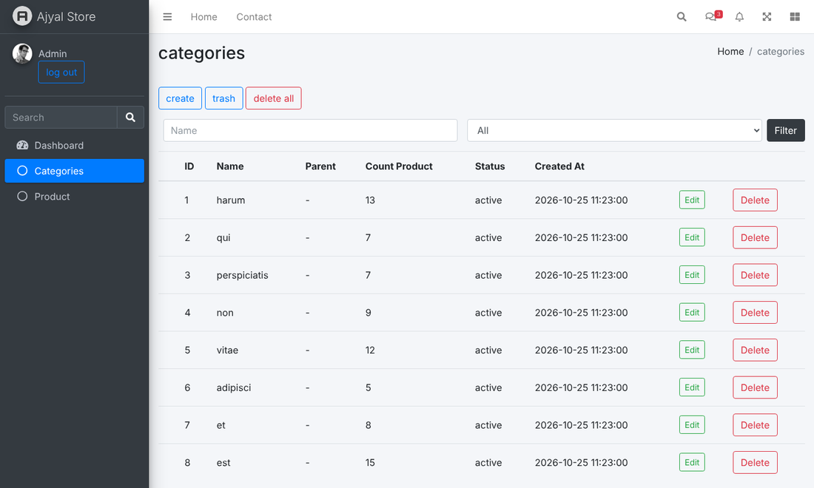

# Laravel Multi-Vendor E-Commerce

A full-stack multi-vendor e-commerce platform built with **Laravel 10** and Blade. Stores and their products are managed from a dashboard, customers browse the storefront, add to cart and check out, and orders trigger notifications and stock updates automatically.


## Screenshots

Captured from the running application with the seeded demo data (Faker; product images fall back to a placeholder).

| Storefront | Product details |
|---|---|
|  |  |

**Cart**


| Admin: products | Admin: categories |
|---|---|
|  |  |

## Features

**Storefront**
- Home page and product listing with product detail pages (slug URLs)
- Shopping cart and checkout with billing/shipping addresses
- Currency converter
- Registration, login, password reset and email verification
- Two-factor authentication (2FA)

**Dashboard**
- Product and category management (create, edit, delete)
- Trash with restore and restore-all for products and categories (soft deletes)
- Product tags
- Store-based setup: stores, vendor profiles and per-store products
- Account types: user, admin, super-admin

**Orders**
- Order, order items and order address models
- On order creation, event listeners automatically **send a notification**, **empty the cart** and **deduct product quantity**

**API**
- Products endpoints under `routes/api.php` (Laravel Sanctum)

## Tech stack

| Layer | Technology |
|---|---|
| Backend | Laravel 10, PHP 8.1+ |
| Auth | Laravel Fortify, Laravel Sanctum |
| Front end | Blade, Tailwind CSS, Vite |
| Database | MySQL |

## Getting started

### Requirements

- PHP 8.1 or higher
- Composer
- Node.js and npm
- MySQL

### Installation

```bash
git clone https://github.com/MohammedAbd20/laravel-multivendor-ecommerce.git
cd laravel-multivendor-ecommerce

composer install
npm install

cp .env.example .env
php artisan key:generate
```

Set your database credentials in `.env`, then:

```bash
php artisan migrate --seed
npm run dev        # in a second terminal
php artisan serve
```

Open `http://127.0.0.1:8000`.

### Demo admin account (local only)

`php artisan migrate --seed` creates a demo admin:

- URL: `http://127.0.0.1:8000/admin/login`
- Email: `admin@example.com`
- Password: `password`

Use it for local development only.

## Project structure

```
app/
├── Http/Controllers/
│   ├── Auth/         # login, register, password, email verification
│   ├── Dashboard/    # products, categories, profile
│   ├── Front/        # home, products, cart, checkout, currency, 2FA
│   └── Api/          # products API
├── Listeners/        # order created: notify, empty cart, deduct stock
├── Notifications/
└── Models/           # Store, Product, Category, Tag, Cart, Order, ...
routes/
├── web.php
├── dashboard.php
├── auth.php
└── api.php
database/
├── migrations/
└── seeders/
```

## Roadmap

- [ ] Online payment gateway integration
- [ ] Product reviews and ratings
- [ ] Coupons and discounts
- [ ] Multi-language support (Arabic / English)

## Author

**Mohammed Hamdi Abdelrahman**: [GitHub](https://github.com/MohammedAbd20) · [LinkedIn](https://www.linkedin.com/in/mohammed-abdelrahman-web/)
